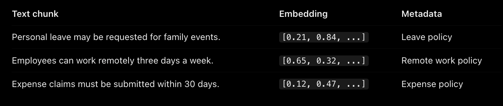
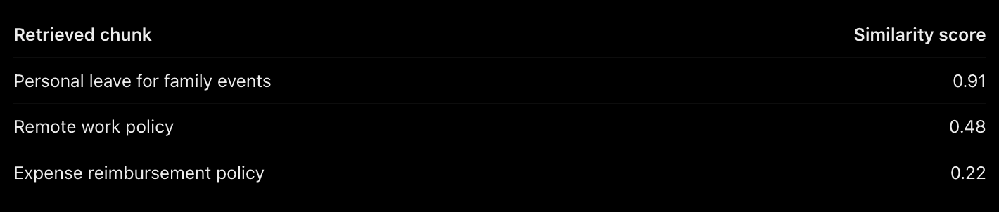

# Week 8, Day 4 - RAG, Vector Search & Similarity Search

*October 17, 2026 · [Originally published on Substack](https://niharikabatra.substack.com/p/week-8-day-4-rag-vector-search-and)*

Yesterday, we explored different chunking strategies and how they help us break large documents into smaller pieces of information.

But once we have these chunks, what happens next?

Imagine you have a 100-page employee handbook. Someone asks an AI assistant:

> **“Can I take a day off to attend my sister’s wedding?”**

The answer might be somewhere in that handbook. But how does the AI find the relevant information without sending all 100 pages to the language model?

Today, let’s explore the next pieces of the RAG puzzle: embeddings, vector databases, vector search, and similarity search.

---
### 1\. How Does Chunking Connect to Vector Search?

First, we split the handbook into smaller chunks using a suitable chunking strategy.

For example:

- Chunk A: Employees may request personal leave for family events.
- Chunk B: Employees can work remotely up to three days a week.
- Chunk C: Expense claims must be submitted within 30 days.

Now we have smaller pieces of information. But we still need a way to find the right chunk when someone asks a question.

That’s where embeddings and vector search come in.

Chunking decides what pieces of information we search through. Embeddings represent those pieces numerically. Vector search helps us find the pieces relevant to the question.

Let’s understand how.

---
### 2\. First, What Are Embeddings?

We briefly introduced embeddings earlier in our series.

> **An embedding is a numerical representation of text that captures aspects of its meaning.**

For example, consider these two sentences:

- “Can I take time off for a family celebration?”
- “Employees may request personal leave for family events.”

The words are different, but the meanings are related.

An embedding model converts each sentence into a list of numbers. These lists are called **vectors**.

Text with similar meanings often has vectors that are close to each other in the embedding space.

You don’t need to understand how the model calculates every number right now. For now, remember this:

> **Embeddings help computers compare the meaning of different pieces of text.**

But once we turn thousands of chunks into vectors, where do we store them?

---
### 3\. What Is a Vector Database?

A vector database stores embeddings and helps us search through them efficiently.

Think of it as a searchable library. Instead of finding information only by document title or exact keywords, we can look for information based on similarity in meaning.

A vector database can store three important things:

- **The text chunk**: The original piece of information.
- **Its embedding**: The numerical representation of the text.
- **Metadata**: Additional information, such as the document name, department, category, or page number.

For example:

The numbers are illustrative, not actual embeddings.

The database keeps the vectors alongside the information they represent, allowing us to retrieve the original text when a relevant match is found.

---
### 4\. What Is Vector Search?

Now let’s return to our original question:

“Can I take a day off to attend my sister’s wedding?”

Here’s what happens.

**First, the system converts the question into an embedding using an embedding model.**

> Next, it s**earches the vector database** for chunks whose embeddings are similar to the question’s embedding. This process is called **vector search.**

The important part is that the system doesn’t need to find the exact words “sister’s wedding” in a document.

It can find a chunk about personal leave for family events because the meanings are related.

For example, the search might consider these chunks:

- Chunk A: Employees may request personal leave for family events.
- Chunk B: Employees can work remotely up to three days a week.
- Chunk C: Expense claims must be submitted within 30 days.

Chunk A is likely to be the most relevant to the question.

The system can then retrieve the most relevant chunks rather than passing the entire handbook to the language model.

But how does it determine which chunks are most similar?

That’s our next concept.

---
### 5\. What Is Similarity Search?

Similarity search is the process of comparing vectors to identify which ones are closest or most similar according to a chosen measure.

One commonly used method is **cosine similarity.**

Imagine two arrows pointing in space. If they point in similar directions, their cosine similarity is higher. If their directions differ more, their similarity is generally lower.

You don’t need to learn the mathematics behind it yet. The important idea is that the system uses a **similarity measure** to compare the question’s embedding with stored embeddings.

For example, a search might return these illustrative scores:

These numbers are only examples. Actual scores depend on the embedding model, the data, and the similarity method.

> **The system can rank the chunks and retrieve the most relevant ones.**

However, a **high similarity score** doesn’t guarantee that a chunk contains the correct answer. It only indicates a **closer** **match** under the chosen measure.

That’s an important distinction because finding relevant information and verifying that it answers a question are not the same thing.

Vector search and similarity search are closely related terms. In practice, they’re often used interchangeably, although vector search describes the broader search process and similarity search emphasizes how matches are compared.

---
### 6\. How Do All These Pieces Work Together in RAG?

Let’s connect everything we’ve learned so far. Notice that the process begins before the user asks a question.

> **Documents are chunked, converted into embeddings, and stored in the database ahead of time. When a question arrives, the system searches those stored vectors and retrieves relevant text.**

The language model then uses that context to formulate a response.

The vector database doesn’t generate the final answer. Its role is to help find information that the language model can use.

---
### 7\. Are Vector Databases the Only Way to Search?

No.

Traditional keyword search and vector search work differently, and each has its strengths.

For example, if someone searches for an exact policy number like `HR-104`, keyword search may be particularly useful.

But if someone asks, “Can I take time off for a family celebration?”, vector search may find relevant information even if the document uses different wording.

Many real-world RAG systems combine keyword search and vector search. This is called **hybrid search.**

Combining the two can help a system find both exact matches and conceptually related information.

We’ll explore more practical design choices as we continue learning about RAG.

---

The key takeaway? A RAG application doesn’t need to give an AI model every document it has. It can first search for a smaller set of potentially relevant information.

But how do all these pieces come together in a working application?

Tomorrow, we’ll build a basic RAG application and see how chunking, embeddings, vector search, and an LLM work together.

**One concept at a time. One step closer to understanding AI.**
