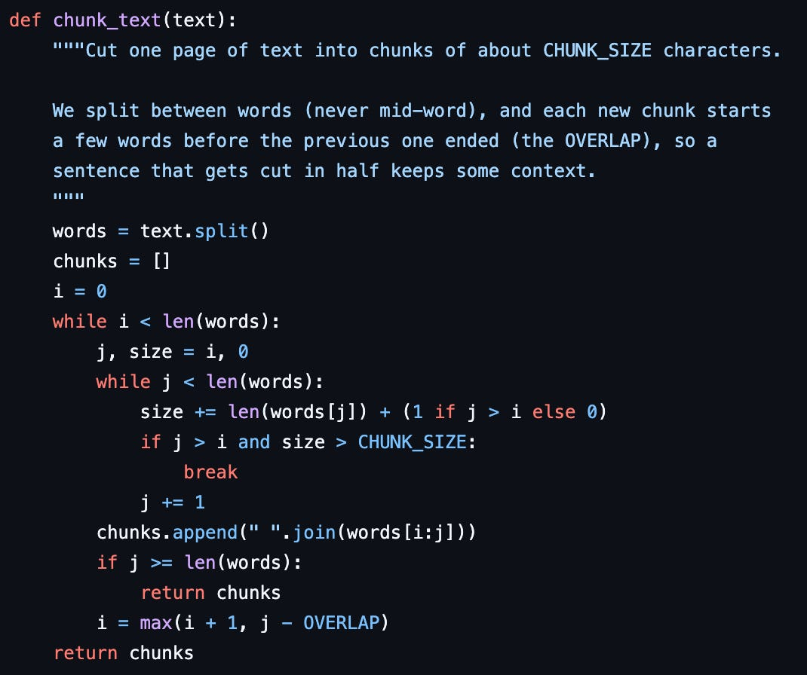
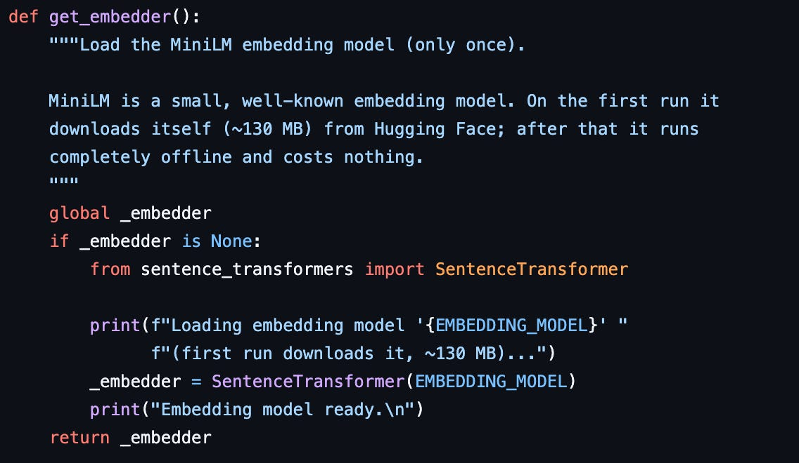
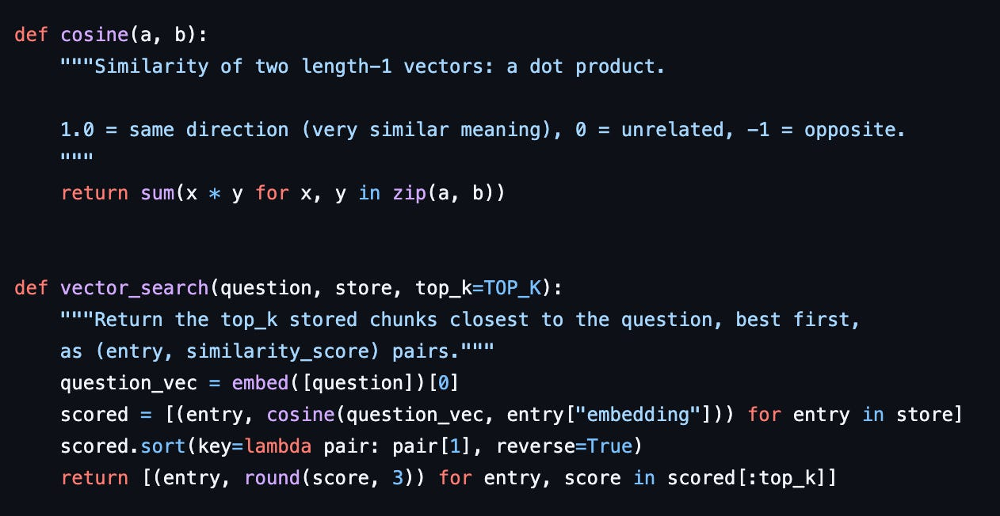
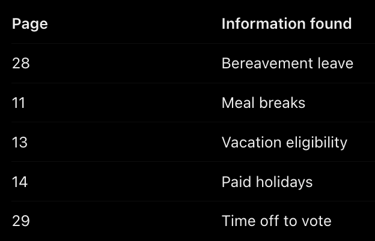
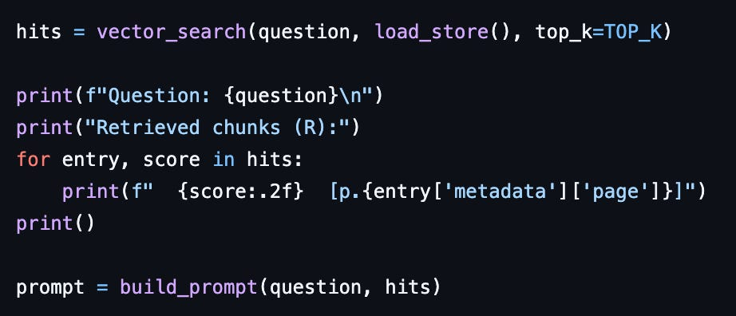
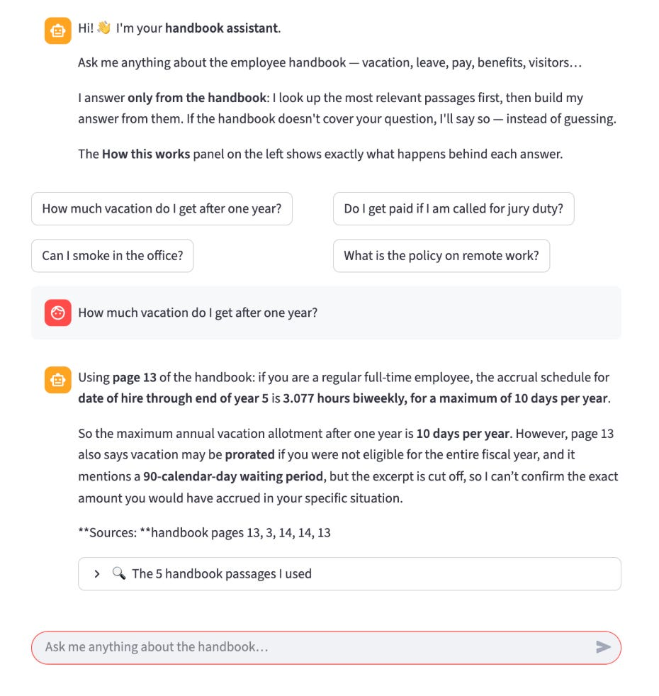

# Week 8, Day 5 - Let's Build a Basic RAG Application

*October 18, 2026 · [Originally published on Substack](https://niharikabatra.substack.com/p/week-8-day-5-lets-build-a-basic-rag)*

Over the past few days, we’ve explored how RAG works.

We learned why AI needs access to information beyond what it already knows, how documents are broken into smaller pieces, and how embeddings and vector search help find relevant information.

Today, let’s put those pieces together.

**We’re going to build a small RAG application that can answer questions using a 40-page employee handbook.**

Imagine asking it:

“Can I take a day off to attend my sister’s wedding?”

The application will search the handbook, find the most relevant passages, and ask a language model to answer using those passages.

And if the handbook doesn’t contain the answer, the application should say so instead of making up a policy.

By the end of this article, you’ll understand how the pieces we’ve learned about work together in a real application.

You can follow along with the complete code in my [basic\_RAG GitHub repository](https://github.com/niharika2309/basic_RAG).

---
### 1\. Before we write any code, let’s understand the plan

A RAG application has two main phases.

**Phase 1: Prepare the document Once**

1\. Break the handbook into smaller pieces.

2\. Turn each piece into numbers that represent its meaning, and save everything.

**Phase 2: Answer questions**

3\. Find the pieces most relevant to the question.

4\. Give those pieces to the language model so it can answer.

Notice something important: the application doesn’t need to process the entire handbook from scratch every time someone asks a question.

> **We prepare the document beforehand. When a question arrives, we search the prepared information and use the relevant pieces to generate an answer.**

Let’s build each part.

---
### 2\. Step 1 — Break the document into smaller pieces

Remember our discussion about chunking?

Instead of giving the AI a 40-page handbook all at once, we’ll divide it into smaller pieces called **chunks**.

For this application, we’ll use a simple approach: each chunk contains approximately 100 words, with a little overlap between consecutive chunks.

Why overlap?

**Imagine a sentence starts at the end of one chunk and continues into the next. Keeping a few words from the previous chunk helps preserve that context.**

We’ll also save the page number for every chunk. Later, this will help us show readers where an answer came from.

Here’s the code:



[View the complete chunking code on GitHub](https://github.com/niharika2309/basic_RAG/blob/main/step1_extract_and_chunk.py)

The code does two main things:

- Reads the text from each page of the PDF.
- Divides that text into smaller pieces and records their page numbers.

Let’s run it:

```plaintext
python step1_extract_and_chunk.py
```

The output looks something like this:

```
Reading data/employee-handbook.pdf ...

Done! 40 pages -> 257 chunks -> chunks.json
```

Our 40-page handbook has now become 257 smaller pieces, saved in `chunks.json`.

Each piece also remembers which page it came from.

One thing to keep in mind: text extracted from PDFs isn’t always perfectly clean. You might notice broken words or repeated headers. **We’re keeping the example simple for now, but real applications often need additional document-cleaning steps.**

What did we accomplish?

We made the handbook easier to search without having to process the entire document every time.

---
### 3\. Step 2 — Give every chunk a meaning fingerprint

Now we have 257 chunks. But how will the application know which ones are relevant to a question?

**This is where embeddings come in.**

As we learned yesterday, an embedding is a numerical representation of text that captures aspects of its meaning. Think of it as a meaning fingerprint.

For example, these two sentences use different words:

- “I need some time away from work.”
- “Can I take leave for a family event?”

Their wording is different, but their meanings are related. Embeddings help a computer recognise that relationship.

In our application, a small AI model called MiniLM converts each chunk into a list of 384 numbers.

Here’s the code:



[View the embedding code on GitHub](https://github.com/niharika2309/basic_RAG/blob/main/step2_embed.py)

Run it with:

```
python step2_embed.py
```

The application converts the chunks into embeddings and saves them in a file called `vector_store.json`.

Each entry contains three things:

- Text: The original chunk from the handbook.
- Embedding: The numbers representing its meaning.
- Metadata: Extra information, such as the page number.

**You might remember that a vector database stores these kinds of information. In this example, we’re using a regular JSON file instead of installing a separate database.**

That’s enough for our small demonstration.

There’s another useful detail: the embedding model runs on your computer. It downloads the model the first time you run it, and you don’t need an API key to generate embeddings.

What did we accomplish?

Every chunk now has a meaning fingerprint that we can compare against a question.

---
### 4\. Step 3 — Find the most relevant chunks

Now comes the interesting part.

Let’s return to our original question:

> **“Can I take a day off to attend my sister’s wedding?”**

The application converts this question into an embedding using the same model.

It then compares the question’s embedding with the embeddings we saved earlier and selects the five closest matches.

This is called **similarity search.**

Here’s the code:



[View the search code on GitHub](https://github.com/niharika2309/basic_RAG/blob/main/step3_search.py)

Let’s run it:

```
python step3_search.py "Can I take a day off to attend my sister's wedding?"
```

The application returns five chunks, along with their page numbers and similarity scores.

Here’s an example of what it finds:



The word “wedding” doesn’t appear anywhere in the handbook.

Yet the application found information about leave, vacation, and other types of time off.

**A basic keyword search that looks only for the exact word “wedding” wouldn’t find these passages. Embeddings allow our application to look for related meanings instead.**

Of course, finding related information doesn’t mean we’ve found the correct answer.

For example, bereavement leave is about taking time off after a death in the family. It isn’t the same as taking time off for a wedding.

The application has found potentially relevant passages, but it still needs to determine whether those passages actually answer the question.

One more detail: the similarity scores aren’t confidence percentages. A score of `0.39` does not mean the application is 39% sure. The scores help rank the results by similarity.

What did we accomplish?

We found five passages that the application considers relevant to our question, even though the exact word we used isn’t in the document.

Now let’s see what happens when we give those passages to a language model.

---
### 5\. Step 4 — Let the language model answer using the retrieved information

So far, our application has prepared the document and found relevant passages.

Now we need a language model to turn those passages into an answer.

This is where the three parts of RAG come together:

- **Retrieve**: Find relevant passages from the handbook.
- **Augment**: Give those passages to the language model along with the question.
- **Generate**: Ask the model to produce an answer using that information.

Here’s the code:



[View the answer-generation code on GitHub](https://github.com/niharika2309/basic_RAG/blob/main/step4_answer.py)

The important part is the instruction we give the model:

> Answer only from the information provided. If the answer isn’t in the excerpts, say so instead of guessing.

Why does this matter?

**A language model can generate a convincing answer even when it doesn’t have the information needed to answer correctly.**

By giving it relevant passages and asking it to stick to those passages, we help ground its response in the document.

Let’s try our wedding question again:

```
python step4_answer.py "Can I take a day off to attend my sister's wedding?"
```

The application produces an answer along these lines:

> The provided handbook excerpts do not contain an answer to whether you can take a day off to attend your sister’s wedding. They only address bereavement leave, time off to vote, meal/rest breaks, vacation eligibility, holidays, and time off for school/child-care activities.
> 
> Sources: page 28, page 11, page 13, page 14, page 29

Notice what happened.

The application didn’t invent a wedding-leave policy. It explained that the information it found doesn’t answer the question and showed the pages it used.

Now let’s ask something the handbook actually covers:

```
python step4_answer.py "How much vacation do I get after one year?"
```

This time, the application finds information about vacation eligibility and accrual. It can use that information to answer the question, citing the relevant handbook pages.

That’s the difference between simply generating an answer and generating an answer grounded in a document.

**One important limitation:** RAG doesn’t guarantee that every answer will be correct. If the application retrieves the wrong passages, or the model misunderstands the information it receives, the answer can still be wrong.

That’s why we’ll explore how to evaluate RAG applications in our next article.

---
### 6\. What if you don’t want to use a terminal?

So far, we’ve run the application using Python commands.

But what if you wanted to ask questions through a familiar chat interface instead?

We have a small web application for that, too.

The same four steps power the interface. The difference is how you interact with the application.

Instead of typing commands, you can open a chat box, ask a question, and see the answer along with the handbook passages used to generate it.

The application uses Streamlit to create this interface.

To run it, use:

```
streamlit run app.py
```

Then open http://localhost:8501 in your browser.



[View the Streamlit application code on GitHub](https://github.com/niharika2309/basic_RAG/blob/main/app.py)

You can also explore the supporting functions in `helpers.py`.

The interface makes the application easier to explore, but the underlying process remains the same: find relevant information, give it to the model, and generate an answer.

> **The complete project is available here:**
> 
> **[Explore the basic\_RAG repository on GitHub](https://github.com/niharika2309/basic_RAG)**

Three things are worth remembering from today’s exercise:

1\. **Prepare once, search when needed.** We split the document and create its embeddings ahead of time. We don’t repeat that work for every question unless the document changes.

2\. **The model doesn’t need the entire document.** We give it a small selection of relevant passages instead of the full 40-page handbook.

3\. **RAG is a collection of understandable steps.** Each part has a specific job, and we can inspect what happens at every stage.

---
### 7\. What this basic application doesn’t cover yet

Our goal was to understand how a basic RAG application works. We deliberately kept the implementation simple.

There are several ways we could improve it:

- **A dedicated vector database:** We’re using a JSON file for now. A proper vector database becomes useful as the amount of information grows.
- **Smarter chunking:** We used fixed-size chunks, but splitting documents by sections, topics, or meaning can sometimes produce better results.
- **Combining search methods:** Using both keyword search and meaning-based search can help find information that either method might miss on its own.
- **Evaluation:** We need a way to measure whether the application is finding the right information and producing useful answers.

We’ll explore these improvements as we continue learning about RAG.

---
### The key takeaway?

A RAG application isn’t a mysterious black box.

> **It’s a process of breaking documents into pieces, finding the most relevant information, and giving that information to a language model to answer a question.**

Today, we built a basic version of that process and saw how each piece fits together.

Tomorrow, we’ll look at how to evaluate our RAG application: how do we know whether it’s retrieving the right information, and what happens when it doesn’t?

**One concept at a time. One step closer to understanding AI.**

**Hope everyone who subscribed has received the GitHub book version!**

**📚 You can revisit any concept whenever you need a refresher.**
