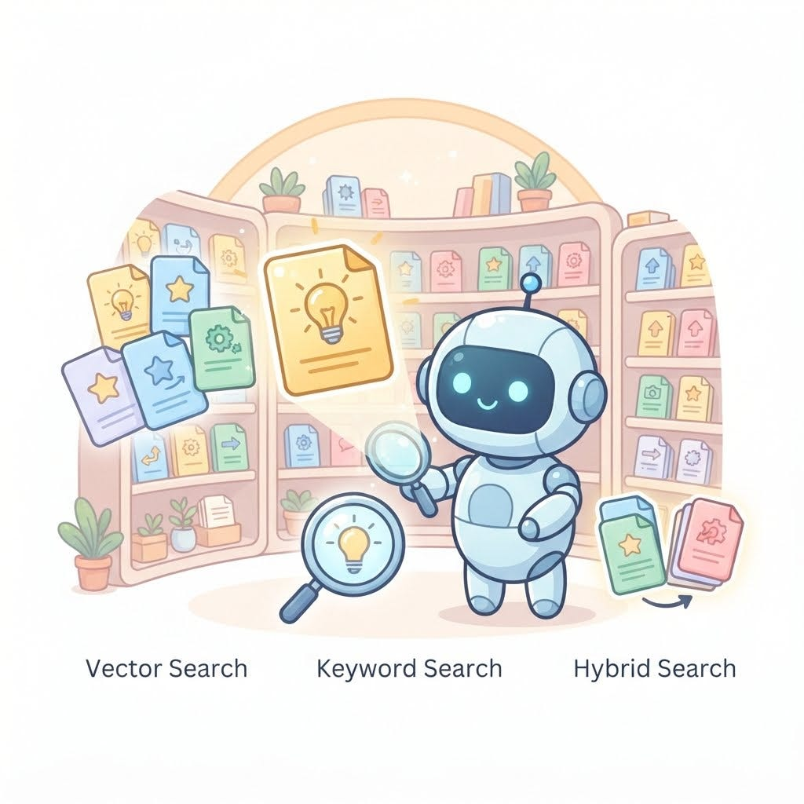
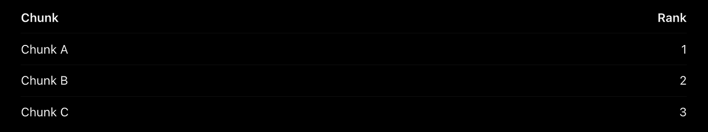
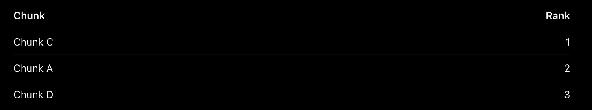

# Week 8, Day 6 - Beyond Vector Search :How Does RAG Retrieve Information?

*October 19, 2026 · [Originally published on Substack](https://niharikabatra.substack.com/p/week-8-day-6-beyond-vector-search)*

Yesterday, we built a basic RAG application.

We took our documents, split them into chunks, converted those chunks into embeddings, stored them as vectors, and retrieved relevant information to answer a question.

But here’s something worth exploring.

Is vector search the only way to find relevant information?

Not at all.

Depending on the question and the documents we’re working with, we can use different retrieval techniques. We can even combine multiple techniques to improve the results.

Today, let’s explore a few of them.

---
### 1\. Vector Search: Finding Meaning

We’ve already covered embeddings, so let’s quickly connect the pieces. Here’s how it works.

Imagine your document contains:

“Employees can carry forward up to five unused vacation days into the next calendar year.”

You ask:

Can I save some of my leave for next year?

**First, an embedding model converts your question into a numerical representation.** The document chunks already have their own embeddings, generated earlier.

The vector search engine then compares the question’s embedding with the stored chunk embeddings using a similarity measure, such as cosine similarity, to find **chunks that are semantically similar** to the question.

Even though your question doesn’t use the exact words from the document, the two can still be close in meaning.

> **That’s the advantage of vector search: it helps find information based on meaning rather than relying only on exact keyword matches.**

It’s particularly useful when users phrase questions differently from how information appears in the documents.

But what happens when we need to find an exact word, name, or policy number?

That’s where keyword search comes in.

---
### 2\. Keyword Search: Finding Exact Words

Imagine you’re asking:

**What does policy HR-204 say about vacation days?**

Your document contains the exact identifier `HR-204`.

**In this case, finding the exact identifier can be more useful than searching by meaning alone.**

Keyword search looks for matching words or terms in documents. One popular technique is BM25, which ranks documents based on factors such as the terms they contain and how frequently those terms appear.

Unlike vector search, keyword search doesn’t rely on embeddings to identify semantically similar text.

It’s particularly useful for finding:

- Employee or customer IDs
- Policy numbers
- Product codes
- Names and technical terms
- Exact phrases

However, keyword search can struggle when the user describes something differently from how it appears in the document.

For example, a user searching for leave might miss a document that only uses the word vacation.

So, what if we could combine the strengths of both approaches?

---
### 3\. Hybrid Search: Combining Meaning and Keywords

That’s exactly what hybrid search does.

**Hybrid search combines keyword-based retrieval with vector search.**

Let’s use our vacation policy example again.

You ask:

What does policy HR-204 say about carrying leave forward?

Two searches can happen:

- Keyword search looks for the exact policy identifier `HR-204` and matching terms.
- Vector search looks for chunks that discuss the meaning of carrying leave forward, even if they use different wording.

Each method returns its own ranked list of results.

But now we have another question: how do we combine those two lists into one?

#### Enter Reciprocal Rank Fusion (RRF)

A common technique for combining ranked search results is Reciprocal Rank Fusion (RRF).

Imagine keyword search ranks the chunks like this:

Vector search returns a different ranking:

Notice that Chunk A appears near the top of both lists, while Chunk C ranks highly in vector search and also appears in the keyword results.

RRF combines these rankings into a single ranking. Chunks appearing near the top of multiple lists can receive higher combined scores.

Why is this useful?

Keyword search and vector search produce different types of scores, and those scores aren’t necessarily directly comparable. **RRF combines the rankings using each chunk’s position in the lists instead of comparing the raw scores.**

You don’t need to remember the technical details right now.

Just remember: hybrid search combines retrieval methods, and RRF is one way to combine their ranked results.

---
### 4\. Metadata Filtering: Narrowing the Search

Let’s say your company has thousands of policy documents across different departments and years.

You ask:

**What is the vacation carry-forward policy for the engineering team in 2026?**

Instead of searching through every document, your application could first narrow the search using metadata such as:

- Department: Engineering
- Year: 2026
- Document type: Vacation policy

It can then perform vector search or hybrid search on the filtered documents.

> **Metadata filtering doesn’t replace vector search or keyword search. It helps narrow down which documents those methods should search through.**

Think of it as choosing the right shelf in a library before looking for a particular book.

This approach is useful when documents have reliable metadata that can help identify the right subset of information.

---
### 5\. Reranking: Putting the Best Results First

Imagine your application retrieves 20 chunks that might be relevant to a question.

Are all 20 equally useful?

Probably not.

The initial retrieval step is often designed to find a broad set of potentially relevant chunks efficiently. But the results might not be in the ideal order.

This is where reranking can help.

> **A reranker takes the retrieved chunks and evaluates how relevant each one is to the user’s question. It then produces a new ranking.**

For example, your initial search might return:

1.  A general company leave policy
2.  A policy about sick leave
3.  The exact vacation carry-forward policy
4.  An article about requesting time off

A reranker might move the exact vacation carry-forward policy to the top because it answers the question more directly.

The application can then send the highest-ranked chunks to the language model.

One important distinction: reranking usually doesn’t replace the initial retrieval step. **It improves the ordering of the results that retrieval has already found.**

And because reranking requires additional computation, it can introduce extra latency and cost.

---
### How do these techniques fit together?

There’s no single retrieval approach that’s best for every RAG application and these techniques aren’t mutually exclusive.

A RAG application might filter documents using metadata, run hybrid search, combine rankings using RRF, and rerank the results before passing the most relevant chunks to the language model.

> **Does every RAG application need all of these? No.**

The right combination depends on the documents, the questions users ask, the quality of the results, and the application’s performance requirements.

---

I initially planned to cover evaluation in more detail this week, including RAGAS. But there’s a lot to understand, and I don’t want us to rush through every concept in a few days.

We’ll take our time with evaluation and explore it gradually, one concept at a time.

For now, I want you to understand the building blocks of RAG and why different approaches exist. We can return to evaluation, metrics, and practical experiments in more depth without trying to learn everything in one week.

Because the goal of this series isn’t to cover as many AI terms as possible.

It’s to understand what we’re building, why we’re building it, and how the pieces fit together.

**One concept at a time. One step closer to understanding AI.**

***📚 Subscribe to get the GitHub book version and revisit any concept whenever you need a refresher!***
