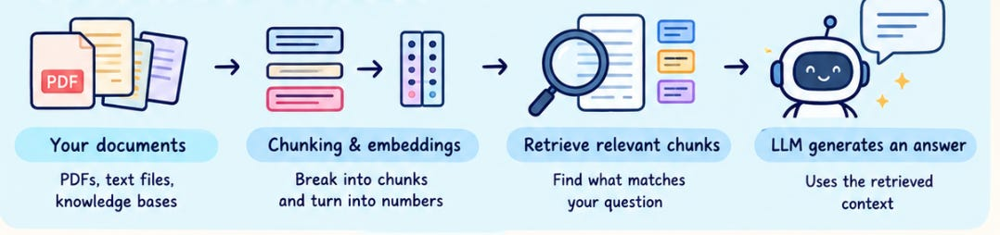
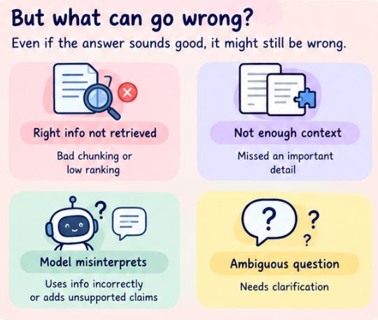

# Week 8, Day 7 - Wrap-Up: Understanding RAG, One Piece at a Time

*October 20, 2026 · [Originally published on Substack](https://niharikabatra.substack.com/p/week-8-day-7-wrap-up-understanding)*

Let's take a step back.

Imagine you're building an AI assistant that answers questions about a company's internal documents. Someone asks, "What is our policy for extending a customer's contract?"

The answer exists somewhere in hundreds of documents. **You don't want the AI to guess, and you certainly don't want it to read every document from beginning to end for every question.**

You want it to find the right information, understand the relevant context, and answer the question using what it found.

> That's the problem **RAG** helps us solve.

Over the past week, we've explored how this works, piece by piece. Now, let's connect everything we've learned and look at what it takes to build a RAG application that people can actually rely on.

> 📄 **Week 8, Day 1 - What Is RAG, and Why Does AI Need It?**
> October 14, 2026 · [Read the original on Substack](08-week-8/day-1-what-is-rag-and-why.md)
---
#### From documents to answers

Think about what happens before an AI application can answer a question using your documents.

First, the documents need to be prepared. A long document can't always be passed to a language model in its entirety, so we break it into smaller chunks. But how we split those documents matters. A poorly chosen chunk might separate a question from its answer or remove the context needed to understand a particular passage.

That's why we explored different chunking strategies, from simple fixed-size chunks to semantic, structural, contextual, and other approaches. There's no single strategy that works best for every document. The right choice depends on the type of information we're working with and how users will search for it.

Next, we need a way to find the right chunks.

> 📄 **Week 8, Day 3 - Chunking Strategies That Make RAG Work Better**
> October 16, 2026 · [Read the original on Substack](08-week-8/day-3-chunking-strategies.md)
---

This is where embeddings and vector search come in. An embedding represents text in a numerical form that allows us to compare its meaning with other pieces of text. When a user asks a question, the system can use these representations to find chunks that are semantically similar to the question.

But finding text with a similar meaning doesn't automatically mean we've found the best answer.

For example, a question about a contract's *renewal period* might retrieve a passage about its *termination period*. The passages may share similar language, but they answer different questions.

> This is why retrieval is an important part of building RAG systems, and why we need to think carefully about how we find and rank relevant information.

Finally, the retrieved chunks are passed to the language model along with the user's question. The model uses that context to generate a response.

The important thing is that RAG doesn't retrain the language model on your documents. It retrieves information when a question is asked and supplies that information as context for generating the answer.

> 📄 **Week 8, Day 4 - RAG, Vector Search & Similarity Search**
> October 17, 2026 · [Read the original on Substack](08-week-8/day-4-rag-vector-search-and.md)
---
#### But what if our RAG application doesn't work well?

Let's return to our company policy assistant.

You've built it, connected your documents, and tested a few questions. The answers look good. You're ready to show it to your team.

Then someone asks a question about a specific exception to the contract policy, and the application gives an incorrect answer.

Where did things go wrong?

There are several possibilities.

- **The right information was never retrieved.** Perhaps the relevant chunk was too small, poorly structured, or ranked too low in the search results.
- **The retrieved information wasn't sufficient.** The system found a related passage but missed another passage containing an important exception.
- **The language model didn't use the information correctly.** The right context was available, but the generated answer misinterpreted it or included unsupported claims.
- **The question itself was ambiguous.** The system may need clarification before it can provide a reliable answer.

Notice something interesting here: all four situations can produce an answer that *sounds* convincing.

Simply reading the response and deciding whether it sounds good isn't enough to tell us whether our application is working well.

We need a more systematic way to evaluate it.

---
#### How do we know if our RAG application is good?

Imagine testing your application with 100 questions. For each question, you know which documents contain the correct information and what a good answer should include.

You can now investigate several things:

- Did the system retrieve the relevant information?
- Was the retrieved information sufficient to answer the question?
- Did the generated answer stay faithful to the available context?
- Did it actually answer what the user asked?

These are different questions, and they measure different parts of the pipeline.

For example, a system might retrieve excellent chunks but still generate a poor answer. Another system might generate fluent answers but consistently retrieve incomplete or irrelevant information.

If we evaluate only the final answer, we might miss the underlying problem.

This is why RAG evaluation matters. It helps us move from *"I think the application works"* to *"I have evidence of how well it works and where it needs improvement."*

And that's an important step when moving from a basic prototype to an application that people can depend on.

---
#### Next week: Evaluating RAG

We've spent this week understanding how RAG works and building the foundation for a basic application.

> 📄 **Week 8, Day 5 - Let's Build a Basic RAG Application**
> October 18, 2026 · [Read the original on Substack](08-week-8/day-5-lets-build-a-basic-rag.md)

Next week, we'll focus on **evaluating** that application.

We'll explore how to assess retrieval quality, check whether answers are supported by retrieved information, understand common failure cases, and use evaluation frameworks such as RAGAS.

We'll also discuss how evaluation results can guide improvements to chunking, retrieval, and answer generation.

The goal isn't just to build a RAG pipeline that works on a few example questions. It's to understand how well it performs across different questions and how to improve it when it doesn't.

> Because building a RAG application is only the beginning. Knowing whether it retrieves the right information and produces reliable answers is what helps us make it better.

If you've followed along this week, I hope RAG feels a little less intimidating than it did at the beginning. You don't need to master every component immediately. Each piece becomes easier to understand once you see how it connects to the others.

**One step at a time. One step closer to understanding AI.**

**📚 Subscribe to get the GitHub book version and revisit any concept whenever you need a refresher!**
