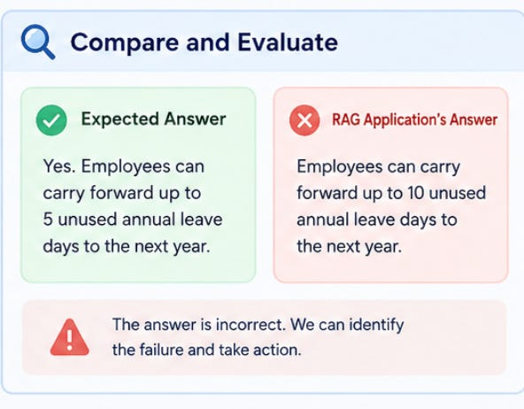

# Week 9, Day 1 - Evaluating RAG with a Golden Dataset

*October 21, 2026 · [Originally published on Substack](https://niharikabatra.substack.com/p/week-9-day-1-evaluating-rag-with)*

> 🔒 **This is a subscriber-only article on Substack.**
> This page mirrors the free preview — **[read the full article on Substack →](https://niharikabatra.substack.com/p/week-9-day-1-evaluating-rag-with)**

Last week, we built a RAG application. It can retrieve information from our documents and use that information to generate an answer.

But here’s a question we haven’t answered yet.

How do we know whether our RAG application is actually working well?

Imagine you’re building a RAG application for your company’s HR team. Employees will use it to ask questions about leave policies, reimbursements, insurance, and other internal procedures.

The application retrieves information from the company’s HR documents and generates an answer.

The answer sounds confident. It’s grammatically correct. It even looks reasonable.

But what if the answer contradicts the actual company policy?

Your application just gave an employee incorrect information that sounds right.

And that’s exactly why evaluating RAG applications matters.

---
### First, what does it mean to evaluate a RAG application?

When we evaluate a RAG application, we need to look beyond how well-written its answers are.

We need to ask a few simple questions:

- Did it retrieve the right information? If the answer was in our documents, did the application find the relevant content?
- Did it use that information correctly? Or did it introduce facts that weren’t present in the retrieved content?
- Did it answer the actual question? Or did it give us a response that sounded relevant but missed the point?

These questions help us understand where our application is working and where it is failing.

But how do we evaluate these things consistently?

Let’s start with a simple idea.

---
### What if we already knew the correct answer?

Imagine you’re building the HR application we just discussed.

Before evaluating it, you could ask an HR specialist to review a set of questions and verify what the correct answers should be. For example:

**QUESTION**

Can I carry forward my unused annual leave to the next year?

**EXPECTED ANSWER**

Yes. Employees can carry forward up to 5 unused annual leave days to the next year.

**REFERENCE DOCUMENT**

The company’s HR leave policy states that employees may carry forward a maximum of 5 unused annual leave days to the following year.

