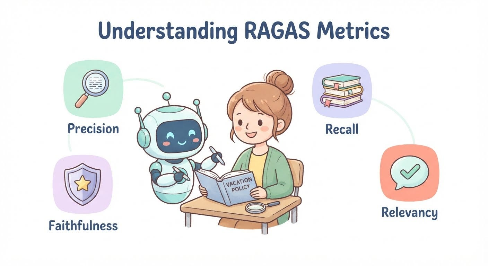

# Week 9, Day 3 - Introducing RAGAS Metrics

*October 23, 2026 · [Originally published on Substack](https://niharikabatra.substack.com/p/week-9-day-3-introducing-ragas-metrics)*

> 🔒 **This is a subscriber-only article on Substack.**
> This page mirrors the free preview — **[read the full article on Substack →](https://niharikabatra.substack.com/p/week-9-day-3-introducing-ragas-metrics)**

Yesterday, we explored LLM-as-a-Judge, where we use an LLM to evaluate another LLM’s answers against specific criteria. But that brings us to another important question.

**What exactly should we evaluate in a RAG application?**

Should we check whether the application retrieved the right information? Whether it used that information correctly? Whether its final answer was relevant to the question?

The answer is: all of these things matter, but they measure different aspects of quality.

**Today, let’s explore a framework called RAGAS and understand the metrics it provides to evaluate RAG applications.**

---
### What is RAGAS?

**RAGAS stands for Retrieval Augmented Generation Assessment.**

> It is an evaluation framework designed to help us measure the quality of RAG applications.

