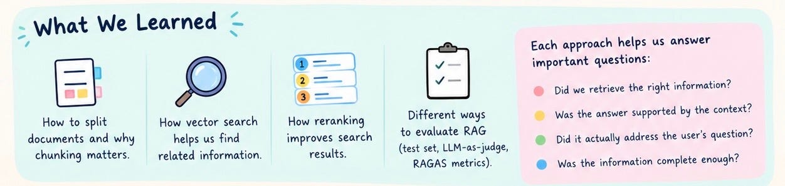
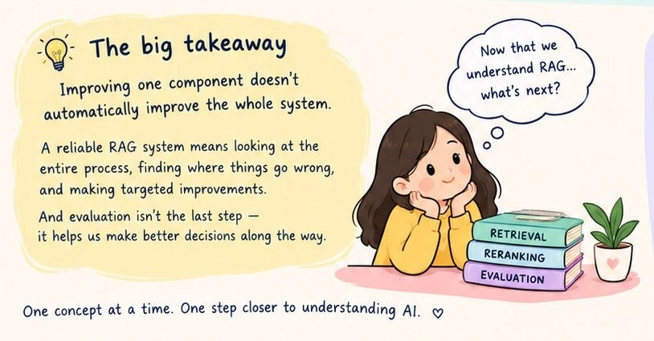

# Week 9, Day 7 - RAG Is More Than Retrieval

*October 27, 2026 · [Originally published on Substack](https://niharikabatra.substack.com/p/week-9-day-7-rag-is-more-than-retrieval)*

When we first started exploring Retrieval-Augmented Generation (RAG), the idea seemed simple: give an AI access to relevant information so it can answer questions more accurately.

But building a RAG system that actually works is a different story.

Finding information is only the beginning. The real challenge is making sure the system finds the right information, understands it in context, and uses it to produce a reliable answer.

Think about an employee asking a company chatbot:

“Can I carry over my unused vacation days into the next benefit year?”

The company policy might contain the answer, but that doesn’t guarantee the chatbot will get it right.

The relevant information could be buried in a long document. The system might retrieve a paragraph that mentions vacation but doesn’t answer the question. Or it might find the right paragraph and still generate an incorrect response.

A RAG system can fail at several stages, even when the information exists in its knowledge base.

> And that’s what makes building RAG systems interesting. We aren’t simply connecting documents to an LLM. We’re designing a process in which every step influences the final answer.

---

**From finding information to trusting the answer**

Over the past two weeks, we’ve moved beyond the basic idea of RAG and started examining what happens inside the system.

We explored how documents are broken into smaller pieces, why the way we split them matters, and how vector search helps us find information related to a question.

We then looked at how retrieval can be improved. Sometimes, the first search returns relevant information alongside less useful results. Reranking helps us reconsider those results and prioritize the passages that best match the question.

> But even better retrieval doesn’t guarantee a good answer.

That brought us to evaluation.

Instead of simply asking whether a response sounds correct, we began examining how to test RAG systematically. We explored the idea of creating a set of questions with expected answers, using an LLM to judge generated responses, and applying RAGAS metrics to examine different aspects of system quality.

Each approach helps us investigate a different question:

- Did the system retrieve the information it needed?
- Was the generated answer supported by the retrieved information?
- Did the answer actually address the user’s question?
- Did the system retrieve enough of the information needed to answer correctly?

These questions matter because a fluent answer isn’t necessarily a trustworthy one.

---

**The bigger lesson**

One of the most important things to understand about RAG is that improving one component doesn’t automatically improve the entire system.

A better retrieval strategy might bring more relevant passages into context, but those passages could still be poorly organized. A stronger prompt might guide the LLM, but it cannot reliably compensate for missing evidence. And a high evaluation score on a small test set doesn’t guarantee that the system will perform equally well on every real-world question.

> Building a reliable system means looking at the entire process, identifying where things go wrong, and making targeted improvements.

This is also why evaluation isn’t something we should leave until the end. It helps us make informed decisions throughout development instead of relying on intuition or a handful of successful examples.

---

**Where do we go from here?**

We’ve now explored the foundations of RAG, from preparing documents and retrieving information to improving search results and evaluating generated answers.

The goal was never just to make a chatbot produce an answer. It was to understand what happens behind that answer, why things go wrong, and how we can improve them.

And this foundation will become even more valuable as we move toward more capable AI systems.

Because once an AI system starts doing more than answering questions — planning tasks, choosing tools, taking actions, and working through multiple steps — reliability becomes an even bigger challenge.

That’s where our next chapter begins.

We’ll move beyond retrieving information and explore AI agents: systems that can decide what to do next, use tools, and work toward a goal.

We’ll build on what we’ve learned rather than starting from scratch.

One concept at a time. One step closer to understanding AI. ❤️

Every week, we’re building a stronger understanding of how modern AI systems work, not just what they can do, but how to build them thoughtfully.
