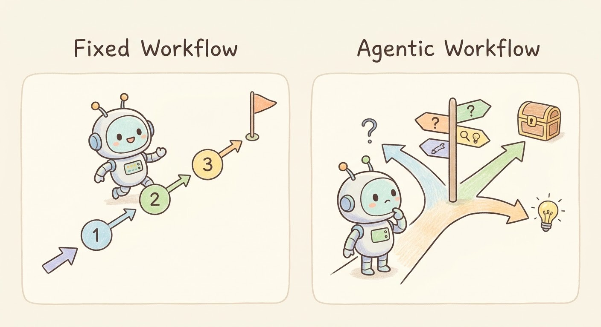

# Week 10, Day 2 - Workflows vs. Agents: When Should AI Follow Rules or Make Decisions?

*October 29, 2026 · [Originally published on Substack](https://niharikabatra.substack.com/p/week-10-day-2-workflows-vs-agents)*

Yesterday, we explored what makes an AI agent different from a chatbot.

Today, let’s look at a decision that comes up when designing AI systems:

> **Should we define every step-in advance, or should we allow the AI to decide what happens next?**

The answer depends on the task.

### Imagine two different tasks

Suppose you are building an AI system to process incoming customer emails.

Some emails ask about delivery dates. Others ask for refunds. Some contain complaints that need human attention.

There are different ways to design this system.

