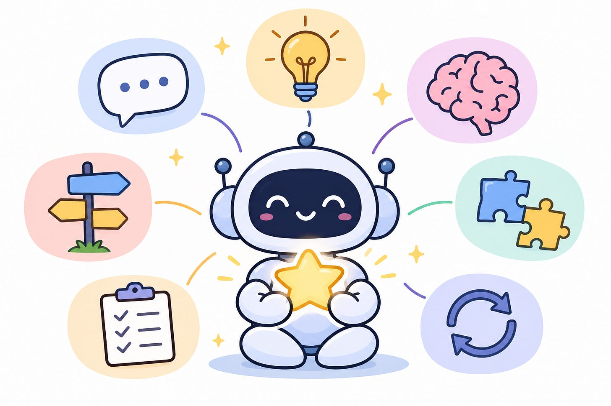

# Week 10, Day 7 - From Chatbots to Autonomous AI Agents

*November 3, 2026 · [Originally published on Substack](https://niharikabatra.substack.com/p/week-10-day-7-from-chatbots-to-autonomous)*

What happens when AI stops waiting for our next question and starts figuring out what to do on its own?

That was the question we explored this week.

We moved beyond the idea of an LLM simply generating a response and started looking at how AI systems can make decisions, remember information, take actions, and work toward a goal.

And perhaps the most important thing we learned is this:

> An AI agent is not just an LLM with a prompt. It is a system that connects reasoning, actions, feedback, and memory.

Let’s revisit some of the key ideas from this week.

---
#### What should you take away from Week 10?

**1\. An AI agent is different from a chatbot.**

A chatbot primarily responds to what we ask. An agent can work toward a goal, decide what to do next, and take actions along the way.

> 📄 **Week 10, Day 1 - What Are AI Agents?**
> October 28, 2026 · [Read the original on Substack](10-week-10/day-1-ai-agents-explained.md)

> AI becomes much more useful when it can do something with the information it generates.

**2\. Not every AI task needs an agentic workflow.**

We explored the difference between predefined workflows and agentic workflows.

A predefined workflow follows instructions we have designed. An agentic workflow gives AI more flexibility to decide the next step.

> 📄 **Week 10, Day 2 - Workflows vs. Agents: When Should AI Follow Rules or Make Decisions?**
> October 29, 2026 · [Read the original on Substack](10-week-10/day-2-workflows-vs-agents.md)

> More autonomy isn’t always better. The right amount of autonomy depends on the task.

**3\. Agents make decisions through a feedback loop.**

An agent doesn’t necessarily know the entire path to its goal in advance.

It can observe the situation, decide on an action, execute it, examine the result, and continue.

> 📄 **Week 10, Day 3 - How Does an AI Agent Decide What to Do Next?**
> October 30, 2026 · [Read the original on Substack](10-week-10/day-3-how-does-an-ai-agent.md)

> The ability to adapt based on feedback is what makes an agent different from a system that simply follows a fixed sequence of steps.

**4\. Memory helps agents maintain context.**

We explored short-term, long-term, and working memory.

Without memory, an agent may lose track of previous actions, user preferences, or information it needs to complete a task.

> 📄 **Week 10, Day 4 - Does an AI Agent Remember What It Did Yesterday? Understanding Agent Memory**
> October 31, 2026 · [Read the original on Substack](10-week-10/day-4-does-an-ai-agent-remember.md)

> Reasoning helps an agent decide what to do. Memory helps it make those decisions using relevant past information.

**5\. Multiple LLM calls can work together to complete a task.**

We explored how an agent can connect LLM calls, actions, memory, and feedback instead of relying on one single response.

> 📄 **Week 10, Day 5 -Let's Build Our First AI Agent**
> November 1, 2026 · [Read the original on Substack](10-week-10/day-5-lets-build-our-first.md)

> Building an agent is not just about calling an LLM. It’s about connecting the different components into a system that works together.

**6\. Autonomous agents need more than a reasoning loop.**

We introduced the ReAct approach and built an autonomous agent that reasons, acts, observes, and repeats.

> 📄 **Week 10, Day 6 - How Does an Autonomous AI Agent Work?**
> November 2, 2026 · [Read the original on Substack](10-week-10/day-6-lets-build-a-simple.md)

But there’s another important piece.

What makes this loop execute reliably? What manages the tools, context, state, and execution? What happens when the agent fails?

This is where the agent harness comes in.

---
#### What’s next?

We’ve spent Week 10 understanding how agents think, remember, decide, and act.

Tomorrow, we begin Week 11 with Agent Harnesses and MCP.

We’ll start by understanding the harness — the system surrounding an agent that helps it execute tasks, interact with tools, manage context, and operate reliably.

Because building an agent that can reason is one thing.

Building an agent that can reliably work in the real world is another.

One concept at a time. One step closer to understanding AI.

See you tomorrow!
