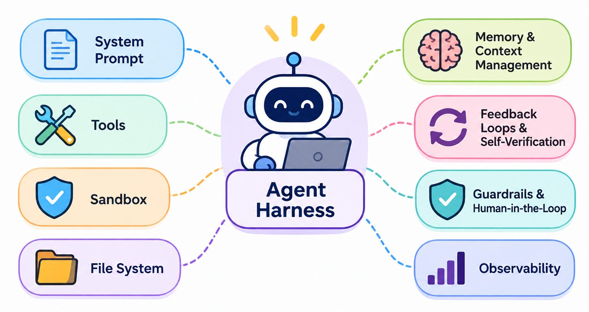

# Week 11, Day 2 - Understanding the Components of an AI Agent Harness

*November 5, 2026 · [Originally published on Substack](https://niharikabatra.substack.com/p/week-11-day-2-understanding-the-components)*

> 🔒 **This is a subscriber-only article on Substack.**
> This page mirrors the free preview — **[read the full article on Substack →](https://niharikabatra.substack.com/p/week-11-day-2-understanding-the-components)**

Yesterday, we introduced a new concept: **Agent Harness.**

We discussed how an LLM alone isn’t enough to build an autonomous AI agent. It needs a supporting system that allows it to interact with the outside world, use tools, manage information, and complete tasks.

Think of the LLM as the brain and the harness as everything that helps the brain get work done.

Today, let’s open up that system and understand what goes inside it.

Imagine asking an AI agent:

> **“Research a company, analyze its latest announcements, and prepare a report.”**

For the agent to complete this task, several things need to work together.

