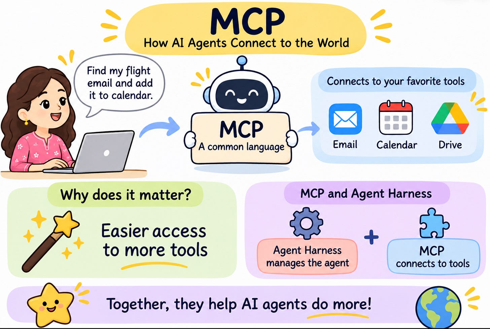

# Week 11, Day 3 - MCP : How AI Agents Connect to the Outside World

*November 6, 2026 · [Originally published on Substack](https://niharikabatra.substack.com/p/week-11-day-3-mcp-how-ai-agents-connect)*

Yesterday, we explored the different components of an agent harness and how they help an AI agent work.

Today, let’s look at something that makes AI agents even more useful: connecting them to the outside world.

Imagine asking your AI assistant:

“Find my flight confirmation email and add the travel dates to my calendar.”

Your AI assistant might know how to understand your request. But how does it access your email or calendar?

This is where MCP comes in.

---
### What is MCP?

MCP stands for **Model Context Protocol.**

> **Think of it as a common language that helps AI applications connect to different tools and information sources.**

Imagine every application speaks a different language. Connecting your AI assistant to each one would require a separate integration.

MCP helps make these connections more **standardized**.

With MCP, AI applications can connect to tools that help them:

- Search files and documents.
- Access information from databases.
- Interact with applications.
- Perform actions such as creating tasks or sending emails.

### Why does this matter?

Imagine building an AI assistant that can access your email, calendar, Google Drive, and Slack.

Without a common approach, developers would have to build and maintain separate integrations for these applications.

MCP makes it easier to create **reusable connections.**

This means AI applications can access more capabilities without developers having to reinvent every integration.

### MCP and Agent Harness – Are They the Same?

Not quite!

Yesterday, we learned about the agent harness.

Think of it this way:

- **Agent Harness**: Provides the environment and manages how an AI agent works.
- **MCP**: Helps the AI application connect to external tools and information.

They solve different problems, but they work together.

---
### The takeaway

MCP doesn’t make an AI model smarter. It makes it easier for AI applications to access the tools and information they need.

And this is an important step toward building AI agents that can do more than just answer questions.

Tomorrow, we’ll explore how MCP actually works, how AI applications discover tools, and how those tools get called.

**One concept at a time. One step closer to understanding AI.**
