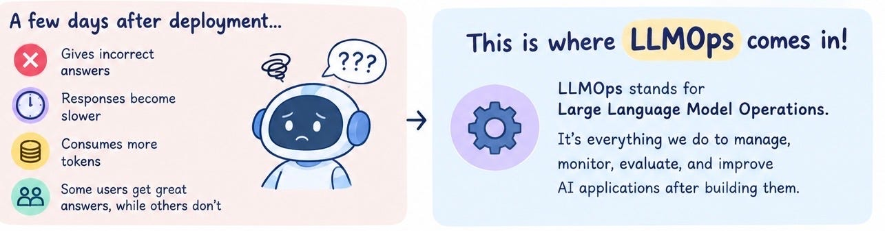

# Week 12, Day 1 - What Happens After We Build an AI Application?

*November 11, 2026 · [Originally published on Substack](https://niharikabatra.substack.com/p/week-12-day-1-what-happens-after)*

Over the past few weeks, we’ve explored how to build AI applications.

We’ve learned about RAG, agents, agentic workflows, harness engineering, and MCP. We even built a few small projects along the way.

But here’s an important question:

Once an AI application is built and deployed, how do we know it’s actually working well?

Imagine you’ve built an AI assistant that answers customer questions.

It works perfectly during testing. You deploy it, and everything looks good initially.

But a few days later:

- It starts giving incorrect answers.
- Responses become slower.
- The application starts consuming more tokens.
- Some users get great answers, while others don’t.

How would you figure out what’s going wrong?

This is where LLMOps comes in.

**What is LLMOps?**

LLMOps stands for Large Language Model Operations.

In simple terms, it’s everything we do to manage, monitor, evaluate, and improve AI applications after building them.

Think of it this way:

Building an AI application is just the beginning. We also need to make sure it continues to work reliably in the real world.

LLMOps helps us do that.

---

**What does LLMOps help us with?**

Let’s look at a few important things.

1\. Monitoring

Are our AI applications working as expected? Are they responding successfully, or are requests failing?

2\. Observability

When something goes wrong, can we understand what happened?

For example, if an AI assistant gives an incorrect answer, we should be able to investigate what information it retrieved, what the model received, and how it generated the response.

3\. Debugging

Once we identify a problem, how do we find its root cause and fix it?

4\. Cost and performance

How much does each request cost? How long does the application take to respond? Are we using more resources than necessary?

---

**What will we explore this week?**

Over the next few days, we’ll explore how developers monitor and understand AI applications in production.

We’ll also get hands-on with tools like Langfuse and Arize Phoenix to understand how they help us trace AI requests, inspect what’s happening behind the scenes, and identify problems.

The goal is to move beyond simply building AI applications and understand how to keep them reliable in the real world.

Because building an AI application that works once is one thing.

Building one that works consistently in production is another.

And that’s what we’re exploring this week!

One concept at a time. One step closer to understanding AI.
