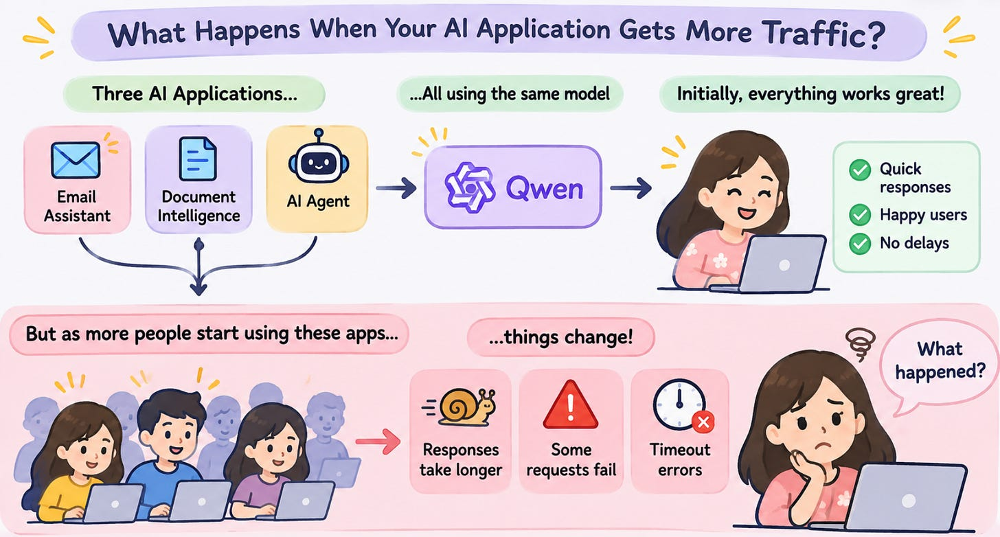

# Week 12, Day 5 - What Happens When Your AI Application Gets More Traffic?

*November 15, 2026 · [Originally published on Substack](https://niharikabatra.substack.com/p/week-12-day-5-what-happens-when-your)*

> 🔒 **This is a subscriber-only article on Substack.**
> This page mirrors the free preview — **[read the full article on Substack →](https://niharikabatra.substack.com/p/week-12-day-5-what-happens-when-your)**

Imagine you’ve built three AI applications.

One is an Email Assistant, another handles document intelligence, and the third is an AI agent.

All three use the same model - let’s say Qwen.

Initially, everything works perfectly. Responses are quick, users are happy, and there are no noticeable delays.

But as more people start using these applications, something changes.

Responses take longer. Some requests fail, and users occasionally see timeout errors.

What happened?

**Your application is now handling more traffic than it was originally designed for.**

Let’s understand why this happens and how we can identify these problems before they affect users.
