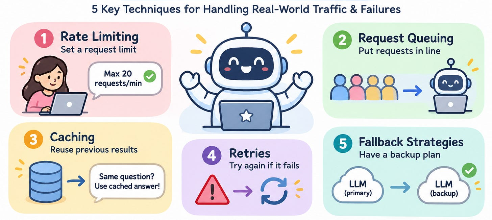

# Week 12, Day 6 - How Do We Make AI Applications Reliable?

*November 16, 2026 · [Originally published on Substack](https://niharikabatra.substack.com/p/week-12-day-6-how-do-we-make-ai-applications)*

> 🔒 **This is a subscriber-only article on Substack.**
> This page mirrors the free preview — **[read the full article on Substack →](https://niharikabatra.substack.com/p/week-12-day-6-how-do-we-make-ai-applications)**

Imagine you’ve built an AI assistant. It works beautifully.

You ask a question, and it responds within seconds. You try another question, and everything works as expected.

Now imagine your application becomes popular. Instead of 5 people using it, 500 people start using it at the same time.

Suddenly, things change.

Some users experience delays. Others receive errors. Some requests fail because the AI service is temporarily unavailable.

The application that worked perfectly during testing is now struggling in the real world.

So, how do we prepare AI applications for situations like this?

Today, let’s explore five techniques that help make AI applications more reliable in production.

