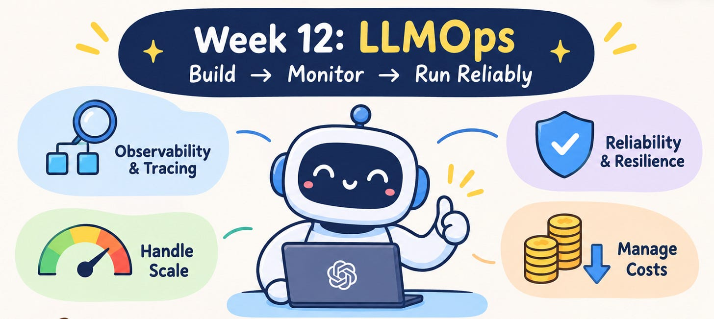

# Week 12, Day 7- Wrapping Up LLMOps :From Building AI to Running It in Production

*November 17, 2026 · [Originally published on Substack](https://niharikabatra.substack.com/p/week-12-day-7-wrapping-up-llmops)*

> 🔒 **This is a subscriber-only article on Substack.**
> This page mirrors the free preview — **[read the full article on Substack →](https://niharikabatra.substack.com/p/week-12-day-7-wrapping-up-llmops)**

Over the last six days, we explored a part of AI engineering that doesn’t always get enough attention: what happens after you build an AI application.

Building an AI application that works is one thing. Making sure it continues to work reliably when real users start using it is an entirely different challenge.

Let’s take a step back and look at what we covered this week.

