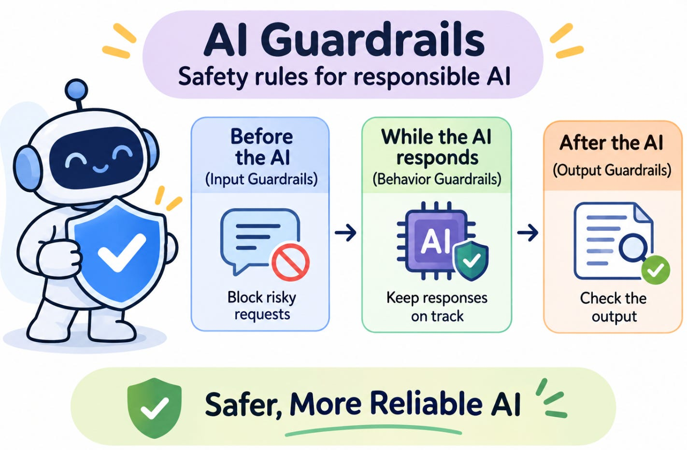

# Week 13, Day 1 - Understanding Guardrails in AI

*November 18, 2026 · [Originally published on Substack](https://niharikabatra.substack.com/p/week-13-day-1-understanding-guardrails)*

> 🔒 **This is a subscriber-only article on Substack.**
> This page mirrors the free preview — **[read the full article on Substack →](https://niharikabatra.substack.com/p/week-13-day-1-understanding-guardrails)**

We’ve spent the last few weeks learning how to build AI applications.

We’ve explored RAG, agents, tool calling, MCP, harnesses, monitoring, and deploying AI systems.

But here’s an important question:

How do we make sure our AI application behaves safely and stays within its boundaries?

